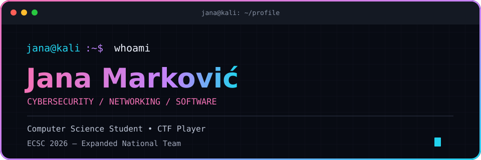

 

### `~/about`

I'm a Computer Science student interested in **cybersecurity, networking, and software engineering**. I enjoy solving CTF challenges, exploring how systems work, and building practical software.

Currently learning through hands-on security challenges and personal projects.

### `~/toolkit`

**Languages**  
`C#` · `Go` · `Python` · `C++` · `Java` · `SQL`

**Development**  
`.NET` · `React` · `Git` · `Docker` · `Linux`

**Security & networking**  
`CTFs` · `Network Security` · `Wireshark` · `Suricata` · `Cisco Networking`

### `~/certifications`

Show certifications & training

- CCNA 1 — Introduction to Networks
- CCNA 2 — Switching, Routing and Wireless Essentials
- CCNA 3 — Enterprise Networking, Security and Automation
- Red Hat DO188 — Containers, Kubernetes and OpenShift
- Linux Essentials
- Python Programming
- Linux Training

---

  <code>curiosity &gt; fear</code>

